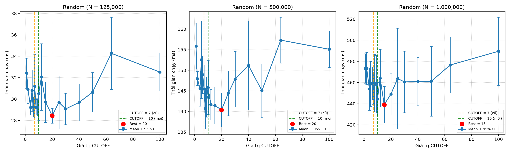
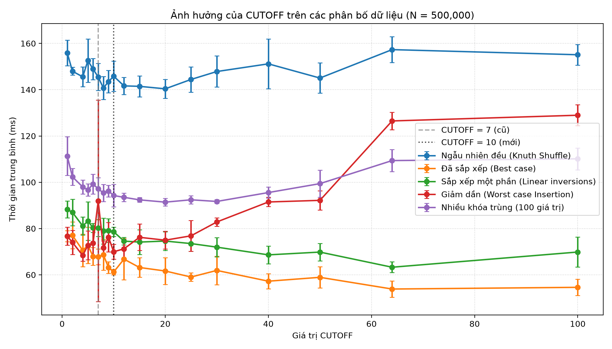
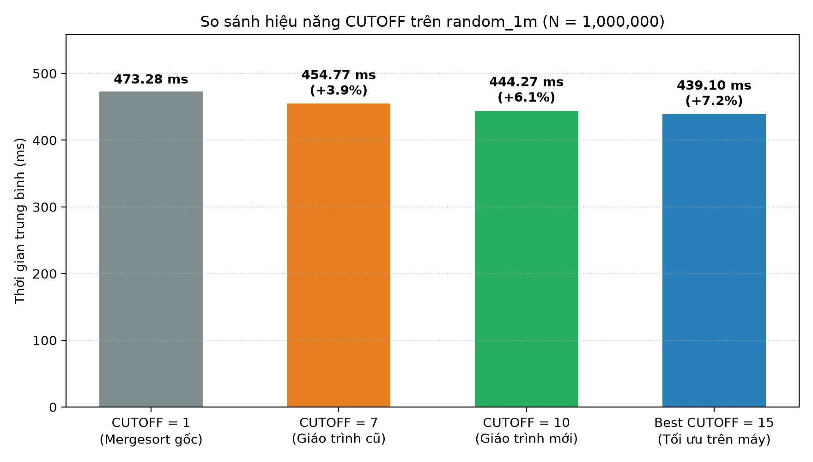
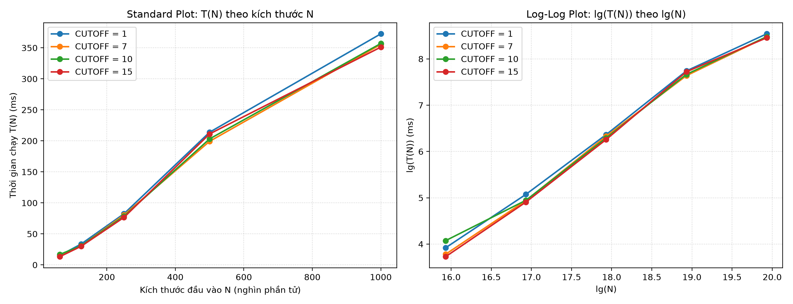

# BÁO CÁO THÍ NGHIỆM: TÌM GIÁ TRỊ CUTOFF TỐI ƯU CHO MERGESORT

- **Sinh viên thực hiện:** Vũ Tiến Đạt – **MSSV:** 25021716
- Môn học: Cấu trúc dữ liệu và Giải thuật (Trường Đại học Công nghệ – ĐHQGHN)
- **Tài liệu tham khảo:** https://docs.google.com/document/d/15JZ6RldAKqNuTkCST1guKjfOaFnlVypV_6JDMrRWmpQ/edit?tab=t.0#heading=h.vv75sv5bn765
- **Log trao đổi với AI:** Xem tại https://share.gemini.google/IOnCaH4v0KPQ

---

## 1. Đặt vấn đề và Cơ sở lý thuyết

### 1.1. Thuật toán Mergesort và cải tiến CUTOFF
Theo bài giảng (mục *Sắp xếp trộn – Mergesort*, trang 229–237), thuật toán **Top-down Mergesort** sử dụng tối đa $N \lg N$ phép so sánh và $6 N \lg N$ lần truy nhập mảng, cùng một mảng phụ `aux[]` kích thước $N$ được cấp phát một lần duy nhất bên ngoài hàm đệ quy.

Tuy nhiên, đối với các mảng con kích thước nhỏ, chi phí phụ cho các lời gọi hàm đệ quy và thao tác sao chép/trộn trở nên đáng kể (trang 238). Bài giảng đề xuất **Cải tiến 1 (CUTOFF)**: khi độ dài mảng con không vượt quá ngưỡng `CUTOFF` (`hi <= lo + cutoff - 1`), thuật toán chuyển sang dùng **Insertion Sort**. Các phiên bản giáo trình nhắc đến hai mốc kinh điển là **CUTOFF = 7** (bản cũ) và **CUTOFF = 10** (bản mới), có thể cải thiện tốc độ đáng kể so với bản nguyên gốc.

### 1.2. Lý do cần thực nghiệm trên cấu hình máy cụ thể
Theo mục *Phân tích thuật toán* (trang 84), thời gian chạy thực tế tuân theo mô hình hàm mũ $T(N) = a N^b$ (hoặc $\sim c N \lg N$ đối với Mergesort):
- **Các yếu tố độc lập hệ thống** (thuật toán, phân bố dữ liệu đầu vào) quyết định bậc tăng (*order-of-growth*).
- **Các yếu tố phụ thuộc hệ thống** (CPU, bộ nhớ đệm L1/L2/L3 cache, trình biên dịch JIT, bộ thu gom rác JVM GC, hệ điều hành) quyết định hằng số thời gian $a$.

Vì `CUTOFF` là điểm cân bằng giữa chi phí gọi đệ quy/sao chép của Mergesort và chi phí bậc hai của Insertion Sort, giá trị tối ưu phụ thuộc trực tiếp vào phần cứng, JVM và cài đặt cụ thể trên từng máy.

### 1.3. Giả thuyết thí nghiệm (Scientific Method – trang 71)
1. **Đường cong dạng chữ U:** Khi tăng `CUTOFF` từ `1`, thời gian chạy sẽ giảm do loại bỏ phần lớn lời gọi đệ quy ở các tầng đáy, đạt cực tiểu trong một vùng phẳng tối ưu, sau đó tăng ngược trở lại khi chi phí $\sim \frac{1}{4}k^2$ (trung bình) hoặc $\sim \frac{1}{2}k^2$ (trường hợp xấu nhất) của Insertion Sort lấn át.
2. **Dịch chuyển trên phần cứng hiện đại:** Giá trị `CUTOFF` tối ưu trên CPU và JVM hiện đại dự kiến nằm cao hơn mốc `7` cổ điển (khoảng từ `10` đến `25`) nhờ L1/L2 cache lớn và cơ chế dự đoán rẽ nhánh (*branch predictor*) tối ưu tốt vòng lặp ngắn của Insertion Sort.
3. **Bảo toàn bậc tăng $N \lg N$:** Khi áp dụng *Doubling Hypothesis* (nhân đôi kích thước $N$), các giá trị `CUTOFF` hằng số đều bảo toàn cùng bậc tăng *linearithmic*, còn việc chọn `CUTOFF` tốt giúp hạ thấp trực tiếp thời gian chạy thực tế.

---

## 2. Thiết kế thí nghiệm

### 2.1. Cấu hình phần cứng và môi trường đo
Thông số được ghi nhận tự động trong [`results/system_info.txt`](results/system_info.txt):

| Thành phần | Thông số |
|---|---|
| Thiết bị | ASUS Vivobook 15 X1502VA |
| Bộ vi xử lý (CPU) | Intel Core i7-13620H |
| Số luồng (CPU Logical Cores) | 16 |
| Hệ điều hành (OS) | Windows 11 10.0 (`amd64`) |
| Phiên bản Java / JVM | Java 26 (`OpenJDK 64-Bit Server VM`) |
| Bộ nhớ Heap tối đa (`-Xmx`) | 2048.00 MB |
| Số lượt lặp mỗi cấu hình (`TRIALS`) | 10 |

### 2.2. Cài đặt thuật toán và phân tích bộ nhớ
- Thuật toán được dựng trực tiếp từ nội dung bài giảng trong [`src/Mergesort.java`](src/Mergesort.java) và [`src/Insertionsort.java`](src/Insertionsort.java), sử dụng interface `Comparable`, thao tác `less()` và `exch()`, bảo toàn tính ổn định (*stability*), cấp phát mảng phụ `aux[]` một lần duy nhất ngoài hàm đệ quy và hỗ trợ bật/tắt **Cải tiến 2** (`stopIfSorted`, trang 239).
- **Ước lượng bộ nhớ trên máy 64-bit (trang 118–122):** Với mảng `Integer[]` độ dài $N$, mảng gốc `a[]` tiêu tốn khoảng $(8N + 24) + 24N \sim 32N$ byte (*deep memory*), mảng phụ `aux[]` tiêu tốn thêm $8N + 24 \sim 8N$ byte (tham chiếu trỏ chung đối tượng). Tại $N = 1{,}000{,}000$, tổng bộ nhớ mỗi lần sắp xếp khoảng $\sim 40\text{ MB}$, nằm gọn trong giới hạn `-Xmx2g`.

### 2.3. Bộ dữ liệu thí nghiệm (`data/`)
Toàn bộ 9 bộ dữ liệu được sinh cố định với `SEED = 42` bằng [`src/DataGenerator.java`](src/DataGenerator.java) để đảm bảo nguyên lý **tái lập được (reproducible)** (trang 71):

| Nhóm dữ liệu | Tên file trong `data/` | Kích thước $N$ | Mô tả |
|---|---|---:|---|
| Dãy nhân đôi kích thước (Knuth Shuffle, tr. 216–218) | `random_62500.txt`, `random_125k.txt`, `random_250k.txt`, `random_500k.txt`, `random_1m.txt` | $62{,}500$ đến $1{,}000{,}000$ | Hoán vị ngẫu nhiên phân bố đều, các khóa phân biệt |
| Trường hợp tốt nhất | `sorted_500k.txt` | $500{,}000$ | Đã sắp xếp tăng dần (*Best case* của Insertion Sort: $N-1$ so sánh, 0 đổi chỗ) |
| Sắp xếp một phần | `partially_sorted_500k.txt` | $500{,}000$ | Tráo cục bộ theo khối 6 phần tử, số *inversion* tuyến tính $O(N)$ (tr. 210) |
| Trường hợp xấu nhất | `reverse_500k.txt` | $500{,}000$ | Giảm dần hoàn toàn (*Worst case* của Insertion Sort: $\sim \frac{1}{2}k^2$ so sánh và đổi chỗ) |
| Nhiều khóa trùng lặp | `few_unique_500k.txt` | $500{,}000$ | Phân bố ngẫu nhiên trên 100 giá trị khóa phân biệt |

### 2.4. Quy trình đo đạc và kiểm soát nhiễu
1. **Dải giá trị khảo sát:** `CUTOFF` $\in \{1, 2, 4, 5, 6, 7, 8, 9, 10, 12, 15, 20, 25, 30, 40, 50, 64, 100\}$, trong đó `CUTOFF = 1` là Mergesort nguyên bản làm mốc đối chứng.
2. **JVM Warm-up:** Chạy khởi động trước khi bấm giờ để JIT Compiler tối ưu hóa bytecode.
3. **Đo thời gian chính xác:** Dùng lớp [`src/Stopwatch.java`](src/Stopwatch.java) (API theo trang 76 bài giảng, nền `System.nanoTime()`), chỉ đo đúng hàm sắp xếp trên bản sao `.clone()` độc lập, và xác minh đầu ra sau mỗi lần chạy bằng `isSorted()`.
4. **Xử lý thống kê:** Dùng [`analyze.py`](analyze.py) tổng hợp từ [`results/cutoff_results.csv`](results/cutoff_results.csv) và [`results/doubling_results.csv`](results/doubling_results.csv) để tính Mean, Std, Median, Min, Max, khoảng tin cậy 95% ($\text{CI}_{95\%} = 1.96 \times \frac{\text{Std}}{\sqrt{n}}$), tỷ số Doubling và phương trình hồi quy Log-Log.

---

## 3. Kết quả thí nghiệm

### 3.1. Bảng 1: So sánh CUTOFF = 1, 7, 10 và Best CUTOFF theo từng bộ dữ liệu

| Bộ dữ liệu | Kích thước ($N$) | Phân bố | CUTOFF=1 (ms) | CUTOFF=7 (ms) | CUTOFF=10 (ms) | Best CUTOFF | Best Mean $\pm$ Std (ms) | Cải thiện vs CUTOFF=1 |
|---|---:|---|---:|---:|---:|---:|---:|---:|
| `few_unique_500k` | 500,000 | few_unique | 111.30 | 97.17 | 94.27 | **20** | **91.40 $\pm$ 2.72** | **+17.88%** |
| `partially_sorted_500k` | 500,000 | partially_sorted | 88.29 | 80.19 | 78.62 | **64** | **63.28 $\pm$ 3.73** | **+28.33%** |
| `random_125k` | 125,000 | random | 32.41 | 31.20 | 30.52 | **20** | **28.44 $\pm$ 1.12** | **+12.27%** |
| `random_1m` | 1,000,000 | random | 473.28 | 454.77 | 444.27 | **15** | **439.10 $\pm$ 27.84** | **+7.22%** |
| `random_500k` | 500,000 | random | 155.89 | 145.49 | 145.82 | **20** | **140.37 $\pm$ 6.64** | **+9.95%** |
| `reverse_500k` | 500,000 | reverse | 76.71 | 91.94 | 69.96 | **4** | **68.36 $\pm$ 4.01** | **+10.89%** |
| `sorted_500k` | 500,000 | sorted | 76.71 | 67.77 | 61.21 | **64** | **53.86 $\pm$ 5.63** | **+29.79%** |

### 3.2. Bảng 2: Thống kê chi tiết theo CUTOFF trên `random_1m` ($N = 1{,}000{,}000$)

| CUTOFF | Mean (ms) | Std (ms) | Median (ms) | Min (ms) | Max (ms) | 95% CI ($\pm$ms) | Cải thiện vs CUTOFF=1 |
|---:|---:|---:|---:|---:|---:|---:|---:|
| 1 | 473.28 | 22.44 | 474.84 | 437.24 | 520.03 | 13.91 | +0.00% |
| 2 | 473.35 | 24.31 | 472.31 | 437.31 | 506.23 | 15.07 | -0.01% |
| 4 | 453.88 | 32.39 | 449.96 | 421.69 | 524.47 | 20.07 | +4.10% |
| 5 | 458.68 | 34.33 | 447.07 | 422.58 | 518.82 | 21.28 | +3.09% |
| 6 | 459.00 | 25.09 | 451.47 | 428.30 | 512.04 | 15.55 | +3.02% |
| 7 | 454.77 | 24.68 | 449.86 | 421.72 | 488.48 | 15.29 | +3.91% |
| 8 | 459.46 | 43.76 | 455.55 | 418.30 | 566.61 | 27.12 | +2.92% |
| 9 | 458.49 | 43.95 | 441.29 | 425.37 | 563.35 | 27.24 | +3.13% |
| 10 | 444.27 | 25.46 | 442.98 | 408.50 | 479.31 | 15.78 | +6.13% |
| 12 | 464.09 | 43.90 | 454.72 | 406.18 | 554.19 | 27.21 | +1.94% |
| **15** | **439.10** | **27.84** | **429.61** | **399.94** | **483.98** | **17.25** | **+7.22%** |
| 20 | 449.06 | 32.08 | 443.74 | 396.91 | 499.30 | 19.88 | +5.12% |
| 25 | 463.81 | 76.69 | 444.86 | 406.20 | 667.09 | 47.53 | +2.00% |
| 30 | 460.57 | 46.91 | 448.03 | 404.87 | 538.18 | 29.08 | +2.69% |
| 40 | 460.90 | 36.79 | 459.04 | 415.74 | 524.50 | 22.80 | +2.62% |
| 50 | 461.19 | 53.30 | 427.70 | 413.10 | 546.25 | 33.03 | +2.56% |
| 64 | 476.53 | 42.87 | 453.99 | 434.49 | 548.72 | 26.57 | -0.69% |
| 100 | 489.58 | 52.01 | 472.83 | 425.36 | 568.44 | 32.23 | -3.44% |

### 3.3. Bảng 3: Kiểm chứng Doubling Hypothesis & Quy tắc hàm mũ $T(N) = a N^b$

#### CUTOFF = 1 — Mô hình hồi quy: $T(N) \approx 3.001 \times 10^{-8} \times N^{1.191}$ giây

| $N$ | Mean $T(N)$ (ms) | Std (ms) | $\text{ratio} = T(2N)/T(N)$ | $\lg(\text{ratio})$ |
|---:|---:|---:|---:|---:|
| 62,500 | 15.14 | 1.56 | — | — |
| 125,000 | 33.69 | 4.05 | 2.224 | 1.153 |
| 250,000 | 82.44 | 7.32 | 2.447 | 1.291 |
| 500,000 | 213.89 | 22.84 | 2.595 | 1.376 |
| 1,000,000 | 372.54 | 17.23 | 1.742 | 0.801 |

#### CUTOFF = 7 — Mô hình hồi quy: $T(N) \approx 2.264 \times 10^{-8} \times N^{1.208}$ giây

| $N$ | Mean $T(N)$ (ms) | Std (ms) | $\text{ratio} = T(2N)/T(N)$ | $\lg(\text{ratio})$ |
|---:|---:|---:|---:|---:|
| 62,500 | 13.75 | 1.23 | — | — |
| 125,000 | 30.73 | 2.30 | 2.235 | 1.160 |
| 250,000 | 80.47 | 10.61 | 2.619 | 1.389 |
| 500,000 | 199.20 | 21.87 | 2.475 | 1.308 |
| 1,000,000 | 355.48 | 25.42 | 1.785 | 0.836 |

#### CUTOFF = 10 — Mô hình hồi quy: $T(N) \approx 4.680 \times 10^{-8} \times N^{1.153}$ giây

| $N$ | Mean $T(N)$ (ms) | Std (ms) | $\text{ratio} = T(2N)/T(N)$ | $\lg(\text{ratio})$ |
|---:|---:|---:|---:|---:|
| 62,500 | 16.85 | 10.98 | — | — |
| 125,000 | 30.83 | 2.67 | 1.829 | 0.871 |
| 250,000 | 78.39 | 8.07 | 2.543 | 1.346 |
| 500,000 | 203.14 | 25.74 | 2.592 | 1.374 |
| 1,000,000 | 356.97 | 25.07 | 1.757 | 0.813 |

#### CUTOFF = 15 — Mô hình hồi quy: $T(N) \approx 1.769 \times 10^{-8} \times N^{1.227}$ giây

| $N$ | Mean $T(N)$ (ms) | Std (ms) | $\text{ratio} = T(2N)/T(N)$ | $\lg(\text{ratio})$ |
|---:|---:|---:|---:|---:|
| 62,500 | 13.26 | 0.89 | — | — |
| 125,000 | 30.01 | 2.42 | 2.264 | 1.179 |
| 250,000 | 76.58 | 6.40 | 2.552 | 1.352 |
| 500,000 | 211.19 | 29.25 | 2.758 | 1.463 |
| 1,000,000 | 351.12 | 28.78 | 1.663 | 0.733 |

### 3.4. Bảng 4: Ảnh hưởng của Cải tiến 2 (`stopIfSorted`, bài giảng tr. 239) ở $N = 500{,}000$

| Bộ dữ liệu | CUTOFF | Tắt `stopIfSorted` (ms) | Bật `stopIfSorted` (ms) | Chênh lệch |
|---|---:|---:|---:|---:|
| `random_500k` | 1 | 155.89 | 217.16 | -39.31% |
| `random_500k` | 7 | 145.49 | 200.85 | -38.06% |
| `random_500k` | 10 | 145.82 | 201.43 | -38.13% |
| `random_500k` | 20 | 140.37 | 205.00 | -46.04% |
| `sorted_500k` | 1 | 76.71 | 3.10 | +95.96% |
| `sorted_500k` | 7 | 67.77 | 2.51 | +96.30% |
| `sorted_500k` | 10 | 61.21 | 2.49 | +95.92% |
| `sorted_500k` | 20 | 61.65 | 2.25 | +96.35% |

### 3.5. Biểu đồ trực quan

**Hình 1: Thời gian chạy theo `CUTOFF` trên dữ liệu ngẫu nhiên ở 3 quy mô $N$**  


**Hình 2: Ảnh hưởng của `CUTOFF` trên 5 phân bố dữ liệu ($N = 500{,}000$)**  


**Hình 3: So sánh hiệu năng giữa `CUTOFF = 1`, `7`, `10` và giá trị tối ưu trên máy**  


**Hình 4: Standard Plot và Log-Log Plot từ Doubling Hypothesis**  


---

## 4. Phân tích và Thảo luận

### 4.1. Thẩm định giả thuyết đường cong hình chữ U và vùng phẳng tối ưu
Quan sát Hình 1 và Bảng 2 (`random_1m`, $N = 1{,}000{,}000$) cho thấy xu hướng chữ U rất rõ rệt:
- Khi tăng `CUTOFF` từ `1` (473.28 ms) lên vùng **`10` – `20`**, thời gian chạy giảm xuống đáy tại **`CUTOFF = 15`** (439.10 ms, trung vị 429.61 ms, cải thiện **+7.22%**).
- Khi vượt quá vùng phẳng tối ưu (`CUTOFF` $\ge 64$), chi phí bậc hai $O(k^2)$ của Insertion Sort bắt đầu vượt quá lợi ích giảm đệ quy: tại `CUTOFF = 64` thời gian tăng lên 476.53 ms (-0.69%, chậm hơn cả bản gốc) và tại `CUTOFF = 100` tăng lên 489.58 ms (-3.44%).
- Trên các mảng ngẫu nhiên quy mô vừa và nhỏ hơn, hiệu quả của `CUTOFF` càng nổi bật: `random_125k` đạt cực tiểu tại `CUTOFF = 20` (**+12.27%**), `random_500k` đạt cực tiểu tại `CUTOFF = 20` (**+9.95%**).

### 4.2. So sánh `CUTOFF = 7` (cũ), `CUTOFF = 10` (mới) và giá trị tối ưu trên máy
Trên bộ dữ liệu ngẫu nhiên lớn nhất `random_1m`:
- **`CUTOFF = 7` (giáo trình cũ):** 454.77 ms (**+3.91%** so với `CUTOFF = 1`).
- **`CUTOFF = 10` (giáo trình mới):** 444.27 ms (**+6.13%** so với `CUTOFF = 1`), nhanh hơn mốc `7` khoảng **2.31%**.
- **`CUTOFF = 15` (tối ưu trên máy):** 439.10 ms (**+7.22%** so với `CUTOFF = 1`), nhanh hơn mốc `7` khoảng **3.45%** và nhỉnh hơn mốc `10` khoảng **1.16%**.

Kết quả này xác nhận giả thuyết rằng trên kiến trúc CPU hiện đại (Intel Core i7-13620H, OpenJDK 26 JIT), giá trị `CUTOFF` tối ưu dịch chuyển lên vùng **`15` – `20`**, cao hơn mốc `7` của các thế hệ phần cứng cũ. Đồng thời, mức tăng tốc thực tế trên dữ liệu ngẫu nhiên $N = 10^6$ (~7% – 10%) thấp hơn mức ước lượng ~20% trong bài giảng (trang 238), bởi trình biên dịch JIT trên JVM hiện đại (Java 26) đã tự động tối ưu (*inlining*, giảm overhead gọi hàm đệ quy) rất tốt cho Mergesort nguyên bản, còn chi phí truy nhập bộ nhớ (cache miss khi đọc/ghi `Integer[]` kích thước lớn) chiếm tỷ trọng chủ yếu.

### 4.3. Ảnh hưởng của phân bố dữ liệu (Bảng 1 và Hình 2)
- **Mảng đã sắp xếp (`sorted_500k`) và sắp xếp một phần (`partially_sorted_500k`):** Do số cặp nghịch thế (*inversion*) bằng 0 hoặc tuyến tính $O(N)$ (bài giảng trang 210), Insertion Sort chạy với thời gian tuyến tính. Vì vậy `CUTOFF` lớn (`64`) đem lại mức cải thiện vượt trội: **+29.79%** trên `sorted_500k` và **+28.33%** trên `partially_sorted_500k`.
- **Mảng nhiều khóa trùng lặp (`few_unique_500k`):** Số phép hoán đổi của Insertion Sort giảm đáng kể do nhiều khóa bằng nhau (vòng lặp dừng sớm nhờ phép so sánh nghiêm ngặt `<`), đạt cực tiểu tại `CUTOFF = 20` (**+17.88%**).
- **Mảng đảo ngược (`reverse_500k` – trường hợp xấu nhất của Insertion Sort):** Do Insertion Sort phải thực hiện $\sim \frac{1}{2}k^2$ phép so sánh và đổi chỗ (trang 208), giá trị tối ưu thu hẹp về **`CUTOFF = 4`** (68.36 ms, +10.89%). Trong khi đó, chọn `CUTOFF` quá lớn (như `64` hoặc `100`) sẽ làm suy giảm hiệu năng mạnh trên dữ liệu đảo ngược. Do đó, lựa chọn `CUTOFF = 15` là điểm cân bằng hợp lý giữa trường hợp trung bình và trường hợp xấu nhất.

### 4.4. Phân tích Doubling Hypothesis, đồ thị Log-Log và yếu tố nhiễu hệ thống
- **Bậc tăng thực nghiệm (Bảng 3 và Hình 4):** Cả 4 cấu hình `CUTOFF` $\in \{1, 7, 10, 15\}$ đều cho số mũ hồi quy $b \in [1.153, 1.227]$ và đường biểu diễn gần như song song trên đồ thị Log-Log. Số mũ $b$ lớn hơn $1$ một chút phản ánh đúng sự hiện diện của nhân tử $\lg N$ (bài giảng trang 82 lưu ý *Doubling Hypothesis* không tách riêng được nhân tử logarit) kết hợp với hiệu ứng tăng tỷ lệ *cache miss* khi kích thước mảng vượt qua dung lượng bộ nhớ đệm L2/L3 ở mốc $N = 250{,}000 \rightarrow 500{,}000$ (nơi `ratio` tăng lên $\approx 2.45 - 2.76$).
- **Xác nhận nhất quán ở Thí nghiệm 2:** Trong bài đo Doubling Test, `CUTOFF = 15` tiếp tục đạt thời gian trung bình thấp nhất ở hầu hết các quy mô kích thước, đạt **351.12 ms** tại $N = 1{,}000{,}000$ (nhanh hơn **+5.75%** so với `CUTOFF = 1` là 372.54 ms, và nhanh hơn cả `CUTOFF = 7` lẫn `CUTOFF = 10`).
- **Nhiễu từ môi trường thực thi (yếu tố phụ thuộc hệ thống – trang 84):** Một số cấu hình có độ lệch chuẩn lớn bất thường do tác động của tiến trình nền Windows, Garbage Collector của JVM hoặc thay đổi xung nhịp Turbo Boost / phân bổ nhân P-core & E-core trên CPU Intel thế hệ 13 (ví dụ: `CUTOFF = 25` trên `random_1m` có Max = 667.09 ms làm Mean bị kéo lên 463.81 ms trong khi Median chỉ là 444.86 ms; hay `CUTOFF = 7` trên `reverse_500k` bị nhiễu lên 91.94 ms). Việc báo cáo đồng thời cả Mean, Median và 95% CI giúp loại trừ kết luận sai lệch do ngoại lai.

### 4.5. Nhận xét thực nghiệm về Cải tiến 2 (`stopIfSorted`, Bảng 4)
- **Trên `sorted_500k`:** Bật `stopIfSorted` giúp giảm thời gian chạy từ 61–77 ms xuống chỉ còn **2.25 – 3.10 ms** (cải thiện **+95.9% đến +96.4%**), chứng thực thời gian chạy tiệm cận tuyến tính $O(N)$ như lý thuyết trang 239.
- **Trên `random_500k`:** Nhánh bật `stopIfSorted` chạy chậm hơn (~200–217 ms so với ~140–156 ms ở lượt đo đầu). Nguyên nhân gồm hai yếu tố: (1) trên dữ liệu ngẫu nhiên, điều kiện `!less(a[mid+1], a[mid])` hầu như luôn sai đối với các mảng con lớn nên làm phát sinh thêm phép truy nhập đối tượng `Integer` và rẽ nhánh thừa mà không bỏ qua được bước `merge()`; (2) lượt đo đối chứng `stopIfSorted = true` được thực thi ở giai đoạn cuối của thí nghiệm (tương đồng với mức ~200–214 ms của `random_500k` trong Doubling Test chạy ngay sau đó), khi CPU có xu hướng hạ xung nhịp nhiệt (*thermal throttling*) và JVM chịu áp lực cấp phát/GC cao hơn so với giai đoạn đầu.

---

## 5. Kết luận

Từ kết quả thực nghiệm đầy đủ trên máy **ASUS Vivobook 15 X1502VA (Intel Core i7-13620H, 16 luồng, Windows 11, Java 26)** với cài đặt Top-down Mergesort dựng trực tiếp từ bài giảng INT2210:

1. **Giá trị `CUTOFF` tối ưu khuyến nghị cho cấu hình máy này là `CUTOFF = 15`** (nằm trong vùng phẳng tối ưu **`10` – `20`**).
2. `CUTOFF = 15` đạt hiệu năng tốt nhất trên dữ liệu ngẫu nhiên quy mô lớn `random_1m` ở cả Thí nghiệm 1 (**439.10 ms**, nhanh hơn **+7.22%** so với `CUTOFF = 1`) lẫn Thí nghiệm 2 Doubling Test (**351.12 ms**, nhanh hơn **+5.75%**), đồng thời vượt trội hơn mốc `7` (giáo trình cũ) và tối ưu hơn mốc `10` (giáo trình mới).
3. Mức `15` đủ lớn để tận dụng tốt L1 cache trên dữ liệu ngẫu nhiên và có khóa trùng lặp (cải thiện ~7% – 18%), nhưng vẫn đủ nhỏ để không gây suy giảm hiệu năng nghiêm trọng trên dữ liệu đảo ngược (trường hợp xấu nhất của Insertion Sort).

---

## 6. Cấu trúc dự án 

```text
projectCUTOFF/
├── README.md                              # Báo cáo thí nghiệm hoàn chỉnh
├── AI_LOG.md                              # Lịch sử trao đổi với AI
├── analyze.py                             # Script Python thống kê và vẽ 4 biểu đồ
├── .gitignore                             # Loại trừ file .class, out/, .idea/, *.iml, *.zip
├── src/
│   ├── Insertionsort.java                 # Insertion Sort theo bài giảng (tr. 205)
│   ├── Mergesort.java                     # Top-down Mergesort + CUTOFF theo bài giảng (tr. 229–239)
│   ├── Stopwatch.java                     # Đồng hồ bấm giờ theo API bài giảng (tr. 76)
│   ├── DataGenerator.java                 # Sinh 9 bộ dữ liệu thí nghiệm (SEED = 42)
│   └── ExperimentRunner.java              # Chạy thí nghiệm CUTOFF và Doubling Hypothesis
├── data/                                  # 9 file dữ liệu thí nghiệm (.txt)
└── results/
    ├── system_info.txt                    # Thông số môi trường đo tự động
    ├── cutoff_results.csv                 # Dữ liệu đo thô thí nghiệm 1
    ├── doubling_results.csv               # Dữ liệu đo thô thí nghiệm 2
    ├── summary_tables.md                  # 4 bảng thống kê tổng hợp
    ├── cutoff_vs_time_sizes.png           # Hình 1
    ├── cutoff_vs_time_distributions.png   # Hình 2
    ├── speedup_comparison.png             # Hình 3
    └── doubling_loglog.png                # Hình 4
```

